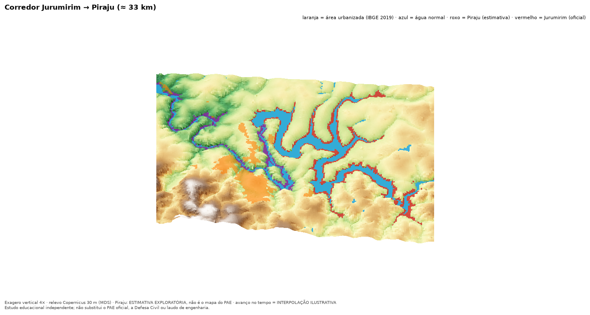

# Jurumirim Flood Risk Explorer

A reproducible Python pipeline and dashboard that analyse the hypothetical dam-break scenarios published in the official Emergency Action Plans (PAEs) for the Jurumirim dam (SP, Brazil) and their effect on the municipality of Piraju.

> Results are conditional scenarios derived from official documents plus labelled exploratory estimates. **They are not a failure forecast**, do not assess the safety of any dam, property, address or route, and do not replace the official PAE, Civil Defense (Defesa Civil) or an engineering assessment. No independent hydraulic simulation is run; reproducing the PAE map does not validate an independent model.

Portuguese: [README.md](README.md). The technical guide ([docs/GUIA_TECNICO.md](docs/GUIA_TECNICO.md)) is in Portuguese.

## Features
- Extraction of the section table and inundation map of the Jurumirim PAE (plate on PDF p. 38), georeferencing (RMS 0.47 m) and vectorization of the ZAS/ZSS polygons.
- Overlay of the envelope with the municipality, urbanized areas (IBGE 2019), terrain (Copernicus GLO-30) and roads (OSM).
- Downstream dams (Piraju, Paranapanema): PAE facts, sections and arrival times (Tables 9/10 read by OCR), ZAS as a river stretch, and an exploratory flood-extent estimate for Piraju, labelled and kept separate from official data.
- Dam filter ("Por Barragem Isolada" or "Todas barragens selecionadas") and exposure metrics (dynamic pressure, lateral reach, altitude, % urbanized area).
- Streamlit dashboard, 6 notebooks and drone-style images/videos.
- Persistent labels: OFFICIAL DATA, DERIVED FROM PAE, EXPLORATORY ESTIMATE, ILLUSTRATION.

## Main results (derived from the Jurumirim PAE, p. 38)
- Modelled reach: ~33 km, from Jurumirim dam to Piraju dam (the PAE does not model beyond it).
- Digitized dam-break envelope (ZAS+ZSS): ≈ 30.4 km² (ZAS ≈ 6.8 km²); raster-to-vector by colour, uncertainty of metres to tens of metres.
- ≈ 5.3 % of the municipality of Piraju (26.8 of 506 km²) lies inside the envelope, mostly rural/riverside land.
- The largest IBGE-2019 urbanized patch of Piraju is ≈ 2.0 km from the envelope (no intersection). Two small patches intersect marginally (3,326 m² in total), the same order as the digitization uncertainty.
- Wave arrival at Piraju dam: 1 h 59 min (rise >= 0.61 m).
- Cascade rupture (Jurumirim, Piraju, Paranapanema) is **not modelled**; the "all dams" mode overlays isolated scenarios.



## Architecture
```
Official PDFs (not in Git) -> extraction -> georeferencing/vectorization --+
IBGE / Copernicus / OSM -> fetch_public_data.py -> GIS (intersections) ----+--> data/processed
                                                                            +--> app/ (Streamlit) · notebooks/ · docs/img
```

## Quick start
Requires Python >= 3.11.
```bash
make setup     # create .venv and install dependencies
make test      # pytest suite
make run       # dashboard at http://localhost:8501
```
`make run` and `make test` work without the official PDFs, using the versioned processed data. Rebuild targets (`make data`, `make dams`, `make estimates`, `make exposure`, `make notebooks`, `make drone`) are described in section 3 of the technical guide.

## Repository layout
```
app/            Streamlit dashboard
src/jurumirim/  package (extraction, georeferencing, vectorization, GIS, terrain, exposure, animation)
scripts/        pipelines and utilities
notebooks/      01 extraction · 02 CRS · 03 DEM · 04 intersection · 05 arrival time and uncertainty · 06 downstream dams
data/           raw (public data), processed (derived), metadata (provenance)
docs/           technical guide, images and presentation (PDF)
tests/          automated tests
```

## Data and licenses
- The PAE and PSB PDFs are third-party documents and are **not redistributed** (git-ignored); the Piraju PSB is marked "Sigilo: Interno" (internal).
- IBGE (open data), Copernicus DEM GLO-30 (Copernicus license) and OpenStreetMap (ODbL 1.0); attributions in section 13 of the technical guide.

## Documentation
- [Technical guide](docs/GUIA_TECNICO.md) (Portuguese): architecture, sources, methodology, validation, limitations, deployment, troubleshooting.
- [Presentation (PDF)](docs/apresentacao/Jurumirim_Flood_Explorer.pdf).
- Exploratory volume scenario (ANUGA), in a separate repository: [simulador-hidro-anuga](https://github.com/RenanCOliveira93/simulador-hidro-anuga).

## License
GPL-3.0. See [LICENSE](LICENSE).
