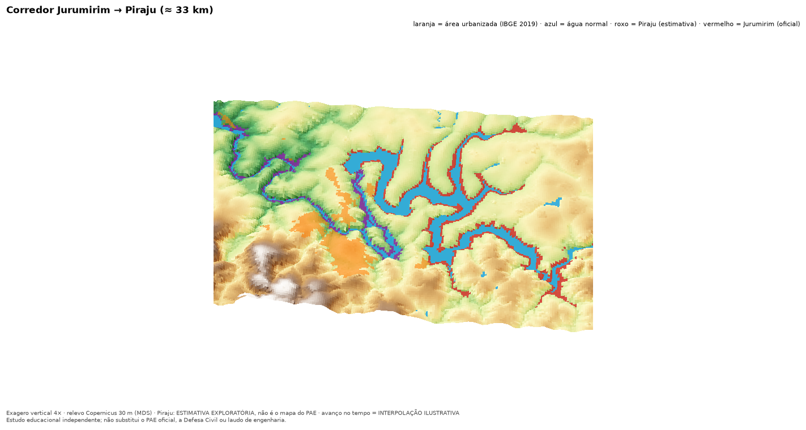

# Jurumirim Flood Risk Explorer

> **Estudo educacional independente; não substitui o PAE oficial, a Defesa Civil ou laudo de engenharia.**

Aplicativo **local** (Python + Streamlit + notebooks reproduzíveis) que investiga a lenda de que uma ruptura da barragem de
Jurumirim inundaria toda a cidade de Piraju-SP, **usando exclusivamente o mapa e as tabelas do PAE oficial**
(CTG Brasil, *PAE Externo UHE Jurumirim*, CTG-SB-PAEE-2026-R0-JUR, jan/2026).

**Não há simulação hidráulica própria.** O PAE é um estudo de emergência, não evidência de falha iminente.
Reproduzir o mapa do PAE não valida um modelo independente. English: [README.en.md](README.en.md).

## O que o estudo encontrou (derivado do PAE, p. 38)
| Pergunta | Resultado | Ressalva |
|---|---|---|
| Alcance modelado | ~33 km, da UHE Jurumirim até a barragem da UHE Piraju | O PAE não modela além da UHE Piraju |
| Envoltória de ruptura (ZAS+ZSS) digitalizada | ≈ 30,4 km² (ZAS ≈ 6,8 km²) | Vetorização por cor de raster; incerteza de metros a dezenas de metros |
| Fração do município de Piraju na envoltória | ≈ 5,3 % (26,8 km² de 506 km²) | Predominantemente rural/ribeirinha |
| Maior mancha urbanizada de Piraju (IBGE 2019) | **≈ 2,0 km** da envoltória, sem interseção | IBGE 2019 ≠ perímetro urbano legal |
| Manchas urbanizadas pequenas e pouco densas que intersectam | 2 polígonos, 3.326 m² no total (≤ 1,1 % de cada) | Ordem da incerteza de digitalização; PAE rotula ST-014/015 como «Área urbana Pirajú ME» |
| Tempo até a UHE Piraju | 1 h 59 min (sobrelevação ≥ 0,61 m) | Tabelado no PAE |

**Isto não classifica nenhum endereço, imóvel ou rota como seguro ou inseguro.** Consulte a Defesa Civil.

## Início rápido (macOS)
```bash
make setup     # cria .venv e instala dependências
make test      # 100+ testes (parser, CRS, geometria, barragens, filtro, app...)
make run       # dashboard em http://localhost:8501
```
`make data` refaz o pipeline (exige o PDF do PAE na raiz e internet para IBGE/Copernicus/OSM).
`make notebooks`, `make video`, `make frames`. Detalhes: [docs/GUIA_MACOS.md](docs/GUIA_MACOS.md).

## Estrutura
- `src/jurumirim/` — pacote (extração, georreferenciamento, vetorização, SIG, terreno, gráficos, animação, relatório)
- `app/` — dashboard Streamlit (Visão geral, Mapa, Seções, Comparação, Método e qualidade, Exportação, Cascata Piraju, Simulação) com **filtro lateral de barragens**
- `notebooks/` — 01 extração PAE · 02 CRS/georreferenciamento · 03 DEM e perfis · 04 interseção · 05 tempo de chegada e incerteza · 06 barragens a jusante (Piraju/Paranapanema)
- `data/processed/`, `data/metadata/` — resultados e procedência (`pae_provenance.json`, `public_data_sources.json`)
- `docs/` — [metodologia](docs/METODOLOGIA.md) · [dados](docs/DADOS.md) · [limitações](docs/LIMITACOES.md) · [licenças](docs/LICENCAS.md) · [validação](docs/VALIDACAO.md) · [storyboard GenAI (opcional)](docs/STORYBOARD_GENAI.md)
- [`VALIDATION_REPORT.md`](VALIDATION_REPORT.md) — comandos realmente executados, resultados e pendências

## Documentação, perguntas e apresentação
- [`docs/DOCUMENTACAO.md`](docs/DOCUMENTACAO.md): documentação completa (resultados, método, limites, referências).
- [`docs/PERGUNTAS_E_RESPOSTAS.md`](docs/PERGUNTAS_E_RESPOSTAS.md): 30 perguntas e respostas (👷 engenheiro, 🏠 morador, 🌍 pessoa de fora); também na página «Perguntas por perfil».
- [`docs/ROTEIRO_APRESENTACAO.md`](docs/ROTEIRO_APRESENTACAO.md): roteiro de vídeo e slides.
- **Visão de drone** (relevo sombreado, 3D, vídeos): `make drone`.



## Etiquetas
`DADO OFICIAL` (valor do PAE) · `DERIVADO DO PAE` (processado) · `ESTIMATIVA EXPLORATÓRIA` · `ILUSTRAÇÃO`.

## Barragens a jusante e filtro do dashboard
Fontes: PAE Jurumirim, **PAE UHE Piraju** (CBA), **PSB de Piraju** e **PAE UHE Paranapanema** (Enel). Veja [`docs/SOURCE_REGISTRY.md`](docs/SOURCE_REGISTRY.md).
- **Filtro lateral** (persiste entre páginas): **«Por Barragem Isolada»** ou **«Todas barragens selecionadas»**. A página *Simulação* e as demais páginas usam esse filtro.
- **Mapa:** Jurumirim traz as manchas ZAS/ZSS do PAE. Piraju e Paranapanema trazem a **ZAS como trecho de rio** (9,68 e 10 km) e a **situação normal** (água atual, OSM) para comparar. Só Piraju tem uma **ESTIMATIVA exploratória de mancha** (relevo até a cota do PAE), separada do dado oficial; veja os limites em `docs/LIMITACOES.md`.
- **«Encadear no tempo»** (opcional, só em «Todas»): hipótese de ruptura sequencial que desloca os relógios pelos tempos dos PAEs; não soma vazões.
- **Página «Altitude, força, extensão e duração»:** pressão dinâmica da água, avanço lateral além da margem normal, % da área urbanizada tocada, altitude × cota da água e o que se pode (e não se pode) dizer sobre duração. `make exposure`.
- Os resultados são **incrementais**: acrescentar uma barragem não apaga nem altera as já selecionadas.
- «Todas» **sobrepõe cenários isolados**, cada um com o relógio da própria ruptura. **Não é simulação de cascata**; a ruptura em cascata permanece **não modelada**.
- Piraju (Tabelas 9/10) e Paranapanema vêm de tabelas/figuras dos PAEs; as Tabelas 9/10 são imagens lidas por OCR **sem revisão de engenheiro**. Posições das seções de Piraju são **ILUSTRAÇÃO**. Não há mancha georreferenciada para Piraju nem Paranapanema nos PDFs.
- Comandos: `make estimates`, `make dams` (usa o OCR versionado), `make ocr` (opcional), `make piraju`. Os PDFs (e derivados do PSB, «Sigilo: Interno») ficam fora do Git. O dashboard inicia sem os PDFs.
- Docs: [`COMPARACAO_JURUMIRIM_PIRAJU.md`](docs/COMPARACAO_JURUMIRIM_PIRAJU.md), [`LIMITACOES.md`](docs/LIMITACOES.md).
