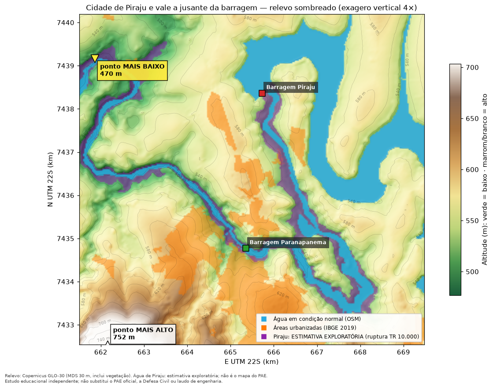
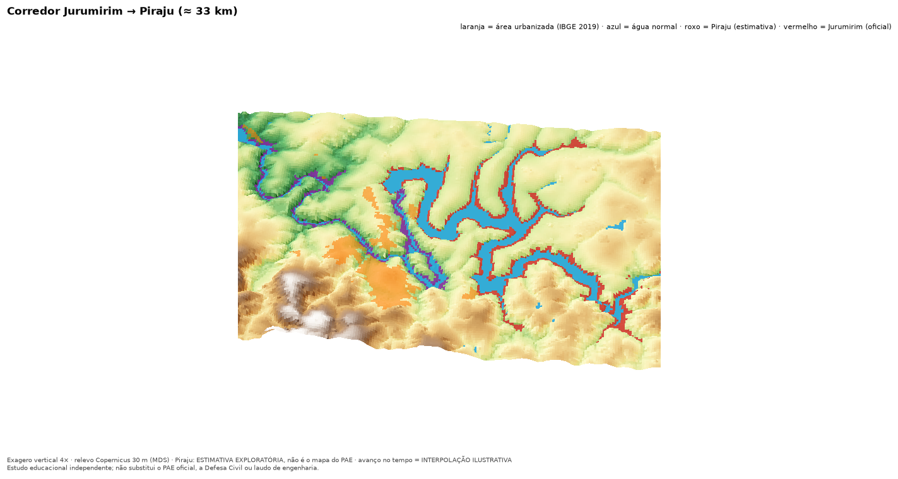

# Jurumirim Flood Risk Explorer — Documentação do projeto

> **Estudo educacional independente; não substitui o PAE oficial, a Defesa Civil ou laudo de engenharia.**

Versão da documentação: 2026-11-05 · Licença do código: GPL-3.0 (arquivo `LICENSE`) · Repositório: `RenanCOliveira93/Jurumirim-Flood_Explorer`

## 1. Resumo
O projeto investiga, com dados oficiais, a pergunta que circula em Piraju (SP): **um rompimento da barragem de Jurumirim inundaria a cidade?** Ele reúne os Planos de Ação de Emergência (PAEs) de **Jurumirim**, **Piraju** e **Paranapanema**, o Plano de Segurança de Barragem (PSB) de Piraju, o relevo de satélite e dados do IBGE e OpenStreetMap, e os apresenta num **dashboard local (Streamlit)**, em **notebooks reproduzíveis** e em **imagens e vídeos estilo drone**.

**Princípio central:** o dashboard não tem simulação hidráulica própria (um cenário exploratório de volume vive num repositório separado, ver [`SIMULADOR_ANUGA.md`](SIMULADOR_ANUGA.md)). O que é oficial é mostrado como oficial; o que o projeto calculou é rotulado como **estimativa**; o que ninguém sabe fica registrado como **lacuna**.

| Rótulo | Significado |
|---|---|
| **DADO OFICIAL** | valor escrito no PAE/PSB |
| **DERIVADO DO PAE** | processamento do dado oficial (vetorização, tabelas, métricas) |
| **ESTIMATIVA EXPLORATÓRIA** | cálculo do projeto (mancha de Piraju: relevo até a cota do PAE) |
| **ILUSTRAÇÃO** | posição ou interpolação para visualizar (não é dado do PAE) |

## 2. Para quem é (três perfis)
| Perfil | O que quer saber | Onde começar |
|---|---|---|
| 👷 **Engenheiro** | método, incerteza, reprodutibilidade, inconsistências das fontes | «Método e qualidade», notebooks 01–06, `VALIDATION_REPORT.md` |
| 🏠 **Morador de Piraju** | a cidade seria alagada? em quanto tempo? quais partes são baixas? | «Visão geral», «Mapa interativo», «Visão de drone» |
| 🌍 **Pessoa de fora** | o que é isso, por que importa, quão confiável é | «Visão de drone», «Perguntas por perfil» |

As perguntas e respostas de cada perfil estão em [`PERGUNTAS_E_RESPOSTAS.md`](PERGUNTAS_E_RESPOSTAS.md) e na página «Perguntas por perfil» do dashboard. O roteiro de vídeo e slides está em [`ROTEIRO_APRESENTACAO.md`](ROTEIRO_APRESENTACAO.md).

## 3. O que foi e o que não foi feito
**Feito**
- Extração do mapa oficial de Jurumirim (prancha p. 38), georreferência (RMS 0,47 m) e vetorização das manchas ZAS/ZSS.
- Tabelas de seções de Jurumirim (17 seções, tempos, vazões, velocidades) e de Piraju (Tabelas 9 e 10 lidas por OCR com checagens).
- Fatos de Piraju, do PSB e da Paranapanema, com página impressa e do PDF.
- Filtro «Por Barragem Isolada» × «Todas barragens selecionadas», simulação da frente da onda (interpolação ilustrativa), hipótese opcional de encadeamento no tempo.
- Estimativa exploratória da mancha de Piraju e métricas de exposição (força, avanço lateral, % de área urbanizada, altitude).
- Visão de drone: relevo sombreado, 3D interativo e vídeos.

**Não feito (de propósito)**
- Simulação hidráulica **no dashboard**, HEC-RAS, nuvem paga. (Existe, fora daqui, um cenário **exploratório de volume** com ANUGA, 24 h simuladas, sem calibração nem revisão de engenheiro: [`SIMULADOR_ANUGA.md`](SIMULADOR_ANUGA.md).)
- Probabilidade de ruptura; classificação de imóveis, endereços ou rotas como seguros/inseguros.
- Extrapolação do cenário de 568,00 m para outras cotas; **ruptura em cascata hidráulica** (permanece `not_modelled`).
- Duração da inundação (os PAEs não trazem hidrograma completo nem recessão).
- IA generativa para desenhar manchas.

## 4. Principais resultados
### 4.1 Jurumirim (mancha oficial, PAE p. 38) — DERIVADO DO PAE
| Pergunta | Resultado | Ressalva |
|---|---|---|
| Alcance modelado | ≈ 33 km, da UHE Jurumirim até a UHE Piraju | o PAE não modela além de Piraju |
| Envoltória (ZAS+ZSS) | ≈ 30,4 km² (ZAS 6,8 km²; ZSS 23,6 km²) | vetorização por cor; erro de metros a dezenas de metros |
| Fração do município de Piraju | ≈ 5,3 % (26,8 de 506 km²) | predominantemente rural/ribeirinha |
| Maior mancha urbanizada de Piraju (IBGE 2019) | ≈ 2,0 km da envoltória, sem interseção | IBGE 2019 ≠ perímetro urbano legal |
| Manchas urbanizadas tocadas | 2 polígonos, 3.326 m² (0,04 % da área urbanizada do município) | mesma ordem da incerteza de digitalização |
| Chegada à UHE Piraju | 1 h 59 min (sobrelevação ≥ 0,61 m) | tabelado no PAE |

### 4.2 Piraju (ruptura isolada) — Tabelas 9 e 10 do PAE (OCR) e estimativa
- **Oficial:** crista 534,00 m, altura 36 m, 105,58 hm³; brecha 179,5 × 20,5 m em 6 min; pico em ST-00 de 22.314 m³/s (TR 10) e 26.857 m³/s (TR 10.000); **ZAS 9,68 km**, **84 edificações** na ZAS; ZSS não definida.
- **Tempos (TR 10.000):** 4 min a 1 km, 17 min a 9 km, 84 min a 29,5 km.
- **Estimativa exploratória:** ≈ 11,5 km² (3,4 km² dentro da ZAS); toca ≈ **1,0 %** da área urbanizada do município (≈ 0,085 km², 5 de 19 manchas). Não é o mapa do PAE (Apêndice 9 ausente dos PDFs).



### 4.3 Paranapanema
ZAS de 10 km; área de mancha ≈ 3,4 km² (ordem de grandeza); o estudo do próprio PAE conclui que as cheias naturais são mais desfavoráveis que a ruptura. **Sem tabela de seções, tempos ou coordenadas**: só a ZAS (trecho de rio) é representada.

### 4.4 Altitude, força, extensão e duração
- **Força (velocidade máxima tabelada):** pressão dinâmica da ruptura de Piraju (TR 10.000) = **5,9×** a da cheia natural (mediana; 1,4× a 23,3×); máximos ≈ 85 kPa (13,0 m/s) × 29 kPa (7,6 m/s); Jurumirim ≈ 45 kPa (9,5 m/s). Valores máximos **no canal**, não no terreno.
- **Avanço lateral além da margem normal:** Jurumirim (oficial) mediana 145 m, 90 % ≤ 443 m, máx. 2,3 km; Piraju (estimativa) mediana 56 m, 90 % ≤ 161 m, máx. 880 m.
- **Altitude × água (Piraju):** mancha urbanizada principal de 491 a 653 m (mediana 583 m); água da ruptura ≈ 517 m na região; 3,3 % do terreno abaixo (teto).
- **Duração:** **não calculável** (sem hidrograma/recessão). Só um teto de massa (Piraju: ≤ ≈ 6 h para 5.000 m³/s acima da base).



## 5. Guia do dashboard
Execute `make run` (http://localhost:8501). A **barra lateral** tem o filtro de barragens, que vale para todas as páginas.

| Página | Para quê |
|---|---|
| Home | achado principal e aviso |
| Mapa interativo | manchas ZAS/ZSS (Jurumirim), ZAS como trecho de rio (Piraju, Paranapanema), estimativa de Piraju, situação normal, municípios, áreas urbanizadas, vias |
| Seções da onda | tempos, vazões, velocidades por seção |
| Comparação | ruptura × cheia natural (Piraju); comparações sempre dentro de cada barragem |
| Método e qualidade | validações, incertezas, fontes |
| Exportação | tabelas, imagens, MP4 |
| Cascata Piraju | registro de fontes, alegações do complemento conferidas, lacunas, cenários A–D |
| Simulação | frente da onda no tempo (interpolação ilustrativa), com o filtro e a hipótese opcional de encadeamento |
| Altitude, força, extensão e duração | respostas quantitativas e limites |
| **Visão de drone** | relevo sombreado, 3D interativo e vídeos |
| Perguntas por perfil | 30 perguntas e respostas (engenheiro, morador, pessoa de fora) |

**Filtro:** «Por Barragem Isolada» mostra uma barragem; «Todas barragens selecionadas» **sobrepõe cenários isolados**, cada um com o relógio da própria ruptura (**não é cascata**). A opção «Encadear no tempo» só desloca relógios (Piraju começa em 1 h 59 min); vazões não se somam.

## 6. Visão de drone
Imagens e vídeos gerados por `make drone` a partir do relevo Copernicus GLO-30 (30 m, superfície): verde-escuro = baixo; marrom/branco = alto; **exagero vertical 4×**; ▲/▼ marcam os pontos mais alto e mais baixo; laranja = área urbanizada (IBGE 2019); azul = água normal (OSM); roxo = estimativa de Piraju; vermelho = mancha oficial de Jurumirim. O avanço da água nos vídeos é **interpolação ilustrativa** entre tempos tabelados por seção. Arquivos: `outputs/drone_orbita_piraju.mp4`, `drone_frente_piraju.mp4`, `drone_frente_jurumirim.mp4` (fora do Git; regeneráveis).

## 7. Metodologia resumida
Detalhes em [`METODOLOGIA.md`](METODOLOGIA.md).
1. **CRS:** SIRGAS 2000 / UTM 22S (EPSG:31982) para todas as medidas.
2. **Jurumirim:** pontos de controle da grade UTM → transformação afim → vetorização por cor → áreas, sobreposição com município e áreas urbanizadas.
3. **Piraju:** Tabelas 9/10 por OCR (duas escalas) com parser que falha se faltar campo; checagens físicas; posição das seções por quilometragem sobre o eixo OSM (ILUSTRAÇÃO), validada contra coordenadas oficiais (46 m e 45 m) e contra a Figura 17 (14 pontos, RMS 7,04 m).
4. **Estimativa de Piraju:** relevo preenchido até a cota máxima tabelada, interpolada em km, só células conectadas ao rio, a jusante da barragem, corredor de 1,5 km. Validação contra a mancha clara da Figura 17 (cenário sem ruptura): cobertura 94,6 % (99,7 % com tolerância de 36 m).
5. **Exposição:** pressão dinâmica ½ρv², carga v²/2g, h·v; avanço lateral em transectos de 500 m; % de área urbanizada; altitude por mancha urbanizada.
6. **Tempo:** só chegada, pico e subida são documentados; teto de massa V/Δ como limite superior.

## 8. Validação e testes
`make test` (mais de 100 testes: parser, CRS, geometria, filtro, encadeamento, exposição, terreno, páginas via `AppTest`). O relatório [`VALIDATION_REPORT.md`](../VALIDATION_REPORT.md) lista os comandos realmente executados, os resultados, as **falhas e correções** (por exemplo: afirmação inicial incorreta sobre interseção urbana; fechamento morfológico que incluía células acima da cota; razão de pressão citada de memória em vez do valor calculado) e as pendências. Não houve teste em navegador real além de `AppTest`/HTTP.

## 9. Limitações (resumo)
1. Sem modelo hidráulico próprio; reproduzir o mapa do PAE não valida um modelo independente.
2. Cenários extremos e hipotéticos; não extrapolar.
3. Incerteza posicional de metros a dezenas de metros (Jurumirim) e de centenas de metros (posição das seções de Piraju).
4. OCR das Tabelas 9/10 sem revisão de engenheiro; resíduo de até 1,15–1,37 m na checagem física não explicado.
5. Estimativa de Piraju não é o mapa do PAE e não valida a ruptura.
6. Relevo é de superfície (vegetação), com erro vertical de metros.
7. Áreas urbanizadas IBGE 2019 ≠ perímetro urbano legal; OSM é colaborativo.
8. Paranapanema sem mancha, seções ou tempos nos PDFs.
9. Duração da inundação não calculável.
10. PSB com «Sigilo: Interno»: derivados fora do Git e das exportações.

Lista completa: [`LIMITACOES.md`](LIMITACOES.md).

## 10. Como executar (macOS)
```bash
git clone git@github.com:RenanCOliveira93/Jurumirim-Flood_Explorer.git && cd Jurumirim-Flood_Explorer
make setup && make test && make run          # http://localhost:8501 (funciona sem os PDFs)
make notebooks                               # 6 notebooks reproduzíveis
make drone                                   # imagens e vídeos de drone (exige ffmpeg)
make estimates && make exposure              # refaz a estimativa de Piraju e as métricas
make data / make dams / make ocr / make piraju   # refazem extrações (exigem os PDFs na raiz)
```
PDFs esperados na raiz (opcionais): `PAE-UHE-Jurumirim.pdf`, `PAE-UHE-Piraju.pdf`, `PSB_UHE_Piraju.pdf`, `PAE-UHE-Paranapanema.pdf`. Guia completo: [`GUIA_MACOS.md`](GUIA_MACOS.md).

## 11. Estrutura do repositório
```
app/            dashboard Streamlit (Home + 10 páginas)
src/jurumirim/  pacote: extração, georreferência, vetorização, SIG, dams, selection, bathtub, exposure, terrain3d, animação
scripts/        pipelines (build_dataset, build_dams, build_estimates, build_exposure, build_drone, fetch_public_data...)
notebooks/      01 extração · 02 CRS · 03 DEM · 04 interseção · 05 tempo/incerteza · 06 barragens a jusante
data/           raw (dados públicos), processed (derivados), metadata (procedência, registro de fontes)
docs/           esta documentação, perguntas, roteiro, metodologia, dados, limitações, licenças, validação
tests/          suíte automatizada
```

## 12. Licenças e uso das fontes
- **Código:** GPL-3.0.
- **PAEs e PSB:** documentos de terceiros; **não são redistribuídos** neste repositório (ficam fora do Git). Os valores aqui citados são transcritos/derivados com fonte e página.
- **IBGE:** dados abertos (citar fonte). **Copernicus DEM GLO-30:** © DLR e.V. 2010–2014 e © Airbus Defence and Space GmbH 2014–2018, fornecido sob licença Copernicus, produzido com dados Copernicus. **OpenStreetMap:** © colaboradores do OpenStreetMap, ODbL 1.0.
- Contatos pessoais presentes nos PAEs **não foram reproduzidos**.

## 13. Glossário
- **PAE:** Plano de Ação de Emergência. · **PSB:** Plano de Segurança de Barragem.
- **ZAS:** Zona de Autossalvamento, trecho a jusante onde a onda chegaria tão rápido que o alerta à população é do empreendedor (definição resumida; ver glossário de cada PAE). · **ZSS:** Zona de Segurança Secundária.
- **TR:** tempo de recorrência (anos) da cheia. · **Cota:** altitude da superfície da água (m). · **MDS:** modelo digital de superfície.
- **Pressão dinâmica:** ½ρv², energia por volume da água em movimento.
- **Cheia natural (sem ruptura):** cheia que passaria pela barragem sem ela romper.

## 14. Referências
**Documentos oficiais (links fornecidos pelo autor do projeto; os PDFs foram baixados manualmente e não são redistribuídos aqui)**
1. CBA. *PAE UHE Piraju*, revisão 5, outubro de 2025 (código 3308-HID-CBA-A-RT-G00-0001; emissão 20/10/2025). <https://d3ltu4sfk36jla.cloudfront.net/cba/PIRAJU_TARJADO_para_site_76f2c48308.pdf>
2. CBA. *PSB UHE Piraju — Sumário Executivo* (PIR-PS-00-RT, rev. 00). <https://d3ltu4sfk36jla.cloudfront.net/cba/PSB_Sumario_Executivo_UHE_Piraju_fd580524df.pdf>
3. CTG Brasil. *PAE Externo UHE Jurumirim* (CTG-SB-PAEE-2026-R0-JUR, R0, jan/2026). Página de arquivos: <https://www.ctgbr.com.br/sustentabilidade/social/seguranca-da-comunidade/pae/pae-arquivos/>
4. Enel Green Power. *PAE UHE Paranapanema* (GRE.OEM.R.88.BR.H.01111.09.003.08, rev. 08, 15/12/2025). <https://www.enel.com.br/pt-saopaulo/quemsomos/archive/d2018-comportamento-etico/plano-de-acao-de-emergencia.html>

Os SHA-256 dos arquivos usados, as edições e as inconsistências encontradas estão em [`SOURCE_REGISTRY.md`](SOURCE_REGISTRY.md). Os links acima não foram acessados automaticamente durante o desenvolvimento; confirme se as versões publicadas são as mesmas.

**Dados públicos**
5. IBGE. *Malha municipal digital* (API de malhas v3, SP). <https://servicodados.ibge.gov.br/api/v3/malhas/estados/35>
6. IBGE. *Áreas Urbanizadas do Brasil 2019*. <https://geoftp.ibge.gov.br/organizacao_do_territorio/tipologias_do_territorio/areas_urbanizadas_do_brasil/2019/Shapefile/AreasUrbanizadas2019_Brasil.zip>
7. Copernicus DEM GLO-30 (AWS Open Data). <https://copernicus-dem-30m.s3.amazonaws.com/>
8. OpenStreetMap contributors, ODbL 1.0. <https://www.openstreetmap.org/copyright>

**Software principal:** Python, Streamlit, GeoPandas, Rasterio, Shapely, PyMuPDF, RapidOCR (opcional), Matplotlib, Plotly, Folium, ffmpeg.
