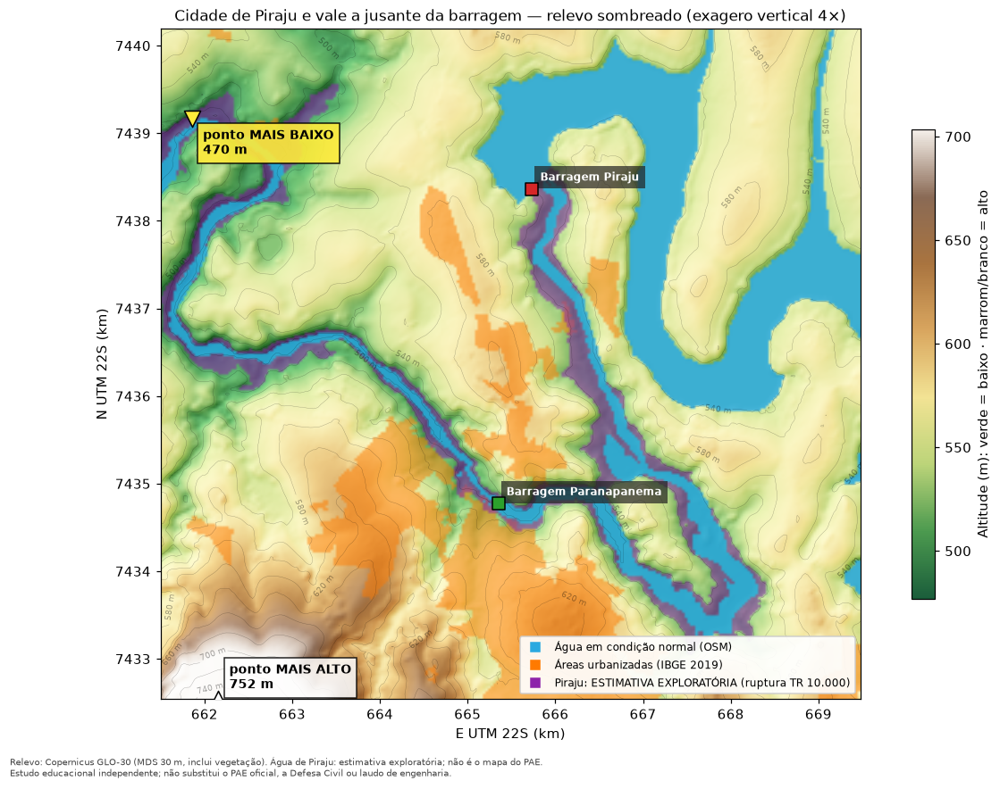
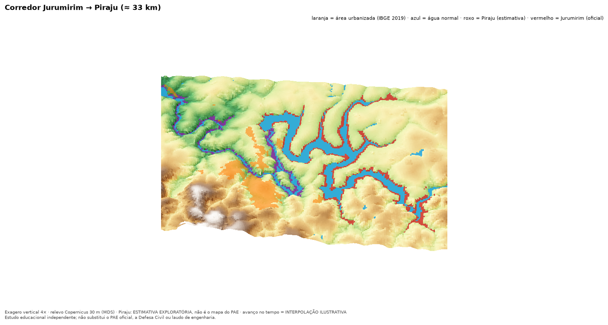
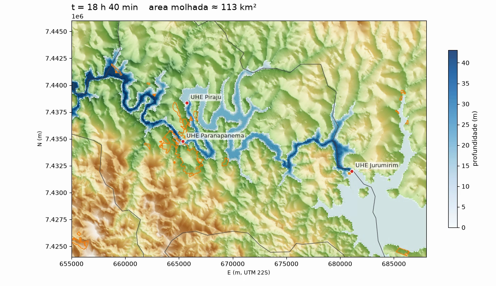

# Jurumirim Flood Risk Explorer: Guia técnico

> Projeto independente. Não substitui o PAE oficial, a Defesa Civil ou laudo de engenharia. Os resultados são **cenários condicionais** extraídos de documentos oficiais e estimativas exploratórias rotuladas; **não são previsão de ruptura** nem avaliação de segurança de barragem, imóvel, endereço ou rota.

Licença do código: GPL-3.0 (`LICENSE`). Repositório: `RenanCOliveira93/Jurumirim-Flood_Explorer`.

## Sumário
1. [Visão geral e escopo](#1-visão-geral-e-escopo)
2. [Arquitetura e estrutura do repositório](#2-arquitetura-e-estrutura-do-repositório)
3. [Instalação e execução](#3-instalação-e-execução)
4. [Fontes de dados e proveniência](#4-fontes-de-dados-e-proveniência)
5. [Metodologia](#5-metodologia)
6. [Resultados](#6-resultados)
7. [Dashboard](#7-dashboard)
8. [Comparação entre barragens e cenários](#8-comparação-entre-barragens-e-cenários)
9. [Cenário exploratório de volume (ANUGA)](#9-cenário-exploratório-de-volume-anuga)
10. [Validação e testes](#10-validação-e-testes)
11. [Limitações conhecidas](#11-limitações-conhecidas)
12. [Publicação (deploy)](#12-publicação-deploy)
13. [Licenças e atribuições](#13-licenças-e-atribuições)
14. [Solução de problemas](#14-solução-de-problemas)
15. [Referências](#15-referências)

---

## 1. Visão geral e escopo

O projeto analisa, com dados oficiais, o alcance da inundação associada a uma ruptura hipotética da barragem de Jurumirim (SP) e o efeito sobre o município de Piraju. Reúne os Planos de Ação de Emergência (PAEs) de **Jurumirim**, **Piraju** e **Paranapanema**, o Plano de Segurança de Barragem (PSB) de Piraju, relevo de satélite e dados do IBGE e do OpenStreetMap, apresentados em um dashboard local (Streamlit), notebooks reproduzíveis e imagens/vídeos de visão de drone.

**Princípio central.** O dashboard não executa simulação hidráulica própria. O que é oficial é mostrado como oficial; o que o projeto calculou é rotulado como estimativa; o que as fontes não trazem é registrado como lacuna.

| Rótulo | Significado |
|---|---|
| `DADO OFICIAL` | valor escrito no PAE/PSB |
| `DERIVADO DO PAE` | processamento do dado oficial (vetorização, tabelas, métricas) |
| `ESTIMATIVA EXPLORATÓRIA` | cálculo do projeto (mancha de Piraju: relevo até a cota do PAE) |
| `ILUSTRAÇÃO` | posição ou interpolação para visualização (não é dado do PAE) |
| `SIMULAÇÃO EXPLORATÓRIA` | cenário hipotético de volume (seção 9; somente no simulador e nos slides) |

**Fora de escopo (por decisão de projeto):** simulação hidráulica no dashboard e uso de HEC-RAS; probabilidade de ruptura; classificação de imóveis, endereços ou rotas como seguros/inseguros; extrapolação do cenário de 568,00 m para outras cotas; ruptura em cascata hidráulica (permanece `not_modelled`); duração da inundação (os PAEs não trazem hidrograma completo nem recessão); IA generativa para desenhar manchas.

**Siglas.** PAE: Plano de Ação de Emergência. PSB: Plano de Segurança de Barragem. ZAS: Zona de Autossalvamento. ZSS: Zona de Segurança Secundária. TR: tempo de recorrência da cheia (anos). MDS: modelo digital de superfície. Cota: altitude da superfície da água (m).

## 2. Arquitetura e estrutura do repositório

```
PDFs oficiais (fora do Git) --> extração (PyMuPDF / OCR opcional) --> georreferência e vetorização
IBGE / Copernicus / OSM  ----> fetch_public_data.py -----------------> SIG (interseções, relevo, exposição)
                                                                        |
                                    data/processed + data/metadata <----+
                                                |
                         dashboard Streamlit (app/) · notebooks · imagens e vídeos
```

```
app/            dashboard Streamlit (Home + páginas em app/pages/)
src/jurumirim/  pacote: extração do PAE, georreferência, vetorização, SIG, dams, selection, bathtub, exposure,
                terrain, terrain3d, animação, relatório
scripts/        pipelines: fetch_public_data, build_dataset, build_dams, build_estimates, build_exposure,
                build_drone, extract_piraju, ocr_pae_images, make_notebooks, setup.sh, rodar.sh
notebooks/      01 extração · 02 CRS · 03 DEM e perfis · 04 interseção · 05 tempo e incerteza · 06 barragens a jusante
data/           raw (dados públicos), processed (derivados), metadata (procedência e registro de fontes)
docs/           este guia, imagens (img/) e apresentação (apresentacao/)
tests/          suíte pytest
```

## 3. Instalação e execução

Requisitos: macOS ou Linux, Python >= 3.11; opcional `ffmpeg` para MP4 (no macOS: `brew install python@3.11 ffmpeg`). `packages.txt` e `Dockerfile` listam os pacotes de sistema para container.

```bash
git clone git@github.com:RenanCOliveira93/Jurumirim-Flood_Explorer.git && cd Jurumirim-Flood_Explorer
make setup     # cria .venv e instala requirements.txt
make test      # suíte pytest
make run       # dashboard em http://localhost:8501
```

`make run` e `make test` funcionam sem os PDFs oficiais, usando os dados processados versionados; sem internet, usam `data/raw` já presente. Alternativa que recria a `.venv` se estiver quebrada e abre o navegador: `./scripts/rodar.sh`.

| Alvo | Função | Requisitos |
|---|---|---|
| `make fetch` | baixa IBGE, Copernicus DEM e OSM | internet |
| `make build` | extrai seções, vetoriza manchas, calcula interseções | `PAE-UHE-Jurumirim.pdf` na raiz |
| `make data` | `fetch` + `build` | idem |
| `make dams` | reconstrói dados de Piraju/Paranapanema a partir do OCR versionado | PDFs na raiz para fatos |
| `make ocr` | opcional: refaz o OCR das Tabelas 9/10 de Piraju | `pip install rapidocr-onnxruntime`; depois `make dams` |
| `make piraju` | registro de fontes (SHA-256) e verificação de alegações | PDFs na raiz |
| `make estimates` | ZAS (trechos) e estimativa exploratória de mancha de Piraju, com validação | dados processados |
| `make exposure` | força, extensão lateral, % urbana, altitude e tempos (depende de `estimates`) | idem |
| `make drone` | mapas de relevo (`docs/img`) e vídeos (`outputs/`) | `ffmpeg` |
| `make notebooks` | gera e executa os 6 notebooks | `jupyter` |
| `make frames` / `make video` | quadros PNG / MP4 da timeline técnica | `video` exige `ffmpeg` |
| `make clean` | remove `outputs/frames` e caches de teste | |

PDFs opcionais, colocados na raiz do projeto (ignorados pelo Git): `PAE-UHE-Jurumirim.pdf`, `PAE-UHE-Piraju.pdf`, `PSB_UHE_Piraju.pdf`, `PAE-UHE-Paranapanema.pdf`.

Se um pacote GIS falhar no Apple Silicon: `brew install gdal` e `pip install --no-binary rasterio rasterio`, ou usar conda-forge.

## 4. Fontes de dados e proveniência

### 4.1 Documentos oficiais (não redistribuídos)

| ID | Documento | Emissor | Código / edição | Págs. |
|---|---|---|---|---|
| SRC-JUR | PAE Externo UHE Jurumirim | CTG Brasil | CTG-SB-PAEE-2026-R0-JUR, R0, jan/2026 | 72 |
| SRC-PIR | PAE UHE Piraju (versão para site) | CBA / Votorantim; HIDROBR (2023); HEAD5 (2025) | 3308-HID-CBA-A-RT-G00-0001; emissão 20/10/2025; capa REV5 nov/2025 | 87 (capa + 86) |
| SRC-PSB | PSB UHE Piraju, Sumário Executivo | CBA | PIR-PS-00-RT, rev. 00 | 17 |
| SRC-PAR | PAE UHE Paranapanema | Enel Green Power | GRE.OEM.R.88.BR.H.01111.09.003.08, rev. 08, 15/12/2025 | 21 |

`make piraju` grava `data/metadata/source_registry.json` com os SHA-256 completos, calculados na execução. Os PDFs ficam fora do Git (`.gitignore`). O PSB traz no cabeçalho **«Sigilo: Interno»**: dados derivados dele (`data/processed/dams/*/psb_*`, `psb_*`) são ignorados pelo Git e excluídos das exportações; confirmar com a CBA se pode ser divulgado antes de publicar qualquer derivado. Contatos pessoais presentes nos PAEs não são reproduzidos.

**Numeração de páginas.** Piraju: página do PDF = impressa + 1 (cabeçalho «Páginas: n de 86»); o projeto cita páginas impressas. Paranapanema: «PAGE n of 21» = página do PDF. Cada fato em `dams_facts.py` traz `page_printed` e `page_pdf`.

**Localização das informações no PAE de Jurumirim (páginas físicas do PDF):**

| Informação | Página |
|---|---|
| Características da UHE (N.A. 559,70/568,00/569,50 m; crista 573,50 m; TR 10.000; vazões 2.229/1.299 m³/s), Tabela 1 | 21 |
| Descrição do estudo: ruptura isolada da barragem de concreto em dia seco, ~33 km até a UHE Piraju | 37 |
| Prancha CTG-SB-DE-2415-JUR: mapa, quadro de seções ST-001...017, legenda, notas (raster + texto vetorial; UTM 22S / SIRGAS 2000) | 38 |
| Caracterização do vale a jusante, ZAS (26 propriedades), levantamento de 2020, ZSS (155 propriedades), Quadro 12 | 52 |
| Importância do tempo de chegada da onda | 54 |
| Figura 12: tempo de chegada nas seções | 55 |

Notas da prancha: tempo de chegada = instante em que a onda atinge sobrelevação de 0,61 m (~2 ft); ZAS = extensão 6,71 km; envoltória = ruptura extrema N.A. 568,00 m.

### 4.2 Dados públicos

| Dado | Fonte | Licença | Datum / resolução | Arquivo |
|---|---|---|---|---|
| Seções ST e mancha | PAE UHE Jurumirim | documento de terceiros (derivados versionados) | UTM 22S, SIRGAS 2000 | `data/processed/pae_*` |
| Município | IBGE, malha municipal v3 (API) | dados abertos IBGE | SIRGAS 2000; ~1:250.000 | `data/raw/ibge_municipios_sp.geojson` |
| Áreas urbanizadas | IBGE, Áreas Urbanizadas do Brasil 2019 | dados abertos IBGE | SIRGAS 2000; ~1:100.000 | `data/raw/ibge_areas_urbanizadas_2019_regiao.gpkg` |
| Relevo | Copernicus DEM GLO-30 (AWS Open Data) | licença Copernicus | WGS84, vertical EGM2008, ~30 m, MDS, erro < 4 m (90 %) | `data/raw/copernicus_glo30_jurumirim_piraju.tif` |
| Vias, água, eixo do rio | OpenStreetMap (Overpass) | ODbL 1.0 | WGS84 | `data/raw/osm_*.json` |
| Seções de Piraju (Tabelas 9/10) | PAE Piraju, p. 61-62 impressas (imagens, lidas por OCR) | terceiros | distância em km (posição ilustrativa) | `data/processed/dams/PIR/` |
| Fatos de Piraju/Paranapanema | PAE Piraju, PAE Paranapanema, PSB | terceiros; PSB com «Sigilo: Interno» | n/a | `data/processed/dams/*/facts.csv` |

Datas de download, URLs e observações: `data/metadata/public_data_sources.json` (gerado por `scripts/fetch_public_data.py`). Procedência do PAE, RMS e qualidade da vetorização: `data/metadata/pae_provenance.json`. O `landuse` urbano do OSM em Piraju é praticamente vazio (7 elementos) e não foi usado como proxy de área urbana.

### 4.3 Inconsistências nas próprias fontes (registradas, não corrigidas)

| Item | Observação |
|---|---|
| Piraju, vertedouro controlado | 2.621 (p. 11) x 2.594 m³/s (p. 14) |
| Piraju, TR 10.000 | Quadro 9: 2.827,20 x Tabela 8 / PSB: 2.829 m³/s |
| Tabela 9, ST-00, TR 10 | cota 532,70 m (> TR 50 = 531,50 e diferente da condição inicial da Tabela 10 = 531,50) |
| Tabela 10, ST-22 | vazão com asterisco sem nota de rodapé; pico não monótono entre ST-09 e ST-10 |
| Paranapanema, área do reservatório | 1,71 x 18,24 km² (N.A. normal x máx. maximorum no mesmo quadro) |
| Paranapanema, código | rev. .08 na capa, .05 no corpo |

Apêndices 8 e 9 de Piraju (memoriais e mapas de inundação) são apenas listados no PDF; os mapas da Paranapanema (Anexos 1-2) também não estão incluídos.

### 4.4 Tabelas 9 e 10 de Piraju (OCR)

São imagens raster, sem texto. Lidas por OCR (RapidOCR, opcional: `make ocr`) em duas escalas, com checagens físicas e de consistência. O JSON bruto fica versionado em `data/processed/dams/PIR/ocr_raw/` (recortes PNG fora do Git). **Não houve revisão por engenheiro**; números críticos devem ser conferidos na p. 62 impressa (Tabela 10).

## 5. Metodologia

### 5.1 Auditoria da fonte
A página física 38 do PAE de Jurumirim é uma prancha A1 (2384x1684 pt, 1:30.000, 01/10/2024). A tabela é texto vetorial; o mapa é raster (41 faixas de imagem com contornos rasterizados); a grade UTM (12 linhas) e os traços das seções ST são vetoriais.

### 5.2 Tabela de seções
`jurumirim.pae.extract_sections`: palavras do PDF agrupadas por linha (y) a partir de cada âncora `ST-xxx`, ordenadas por x; números no formato BR e hh:mm convertidos. Dupla checagem: valores comparados com a prancha renderizada em alta resolução e testes de faixa, monotonicidade e valores conhecidos (`tests/test_pae.py`). Ausência (`-`, vazão da ST-017) vira `NaN`.

### 5.3 Georreferenciamento e vetorização
- **CRS** da prancha: SIRGAS 2000 / UTM 22S (EPSG:31982). Transformação afim pt para UTM ajustada por mínimos quadrados a 36 cruzamentos da grade; RMS 0,47 m.
- **Checagem independente:** o ponto central tabelado de cada ST cai a < 1 m do traço da seção (ST-001 não tem traço próprio).
- **Vetorização por cor:** linhas da legenda (ZAS 255,0,0; ZSS 75,230,0; cheia sem ruptura 0,92,230) segmentadas em HSV; esqueleto; ligação de pontas livres a outro componente (<= 90 px, cerca de 320 m) para fechar lacunas causadas por rótulos e ícones; preenchimento do interior; contorno para UTM; simplificação de 2,5 m. A tabela sobreposta ao mapa é excluída.
- **Derivados:** envoltória = ZAS união ZSS; ZSS_APENAS = envoltória menos ZAS. A cheia sem ruptura é recortada à envoltória + 40 m (ruído de reservatório/hidrografia), com **confiança baixa**.
- Interseções sempre em EPSG:31982 (`assert crs.is_projected`).

### 5.4 Dados públicos e terreno
IBGE (malha municipal; áreas urbanizadas 2019), Copernicus GLO-30 (EGM2008), OSM (vias). Perfis de terreno ao longo dos traços das seções (passo de 30 m) são descritivos; cota de terreno não é comparada com sobrelevação para estender a mancha.

### 5.5 Timeline
Marcadores nos tempos tabelados, sem interpolação. O modo opcional de interpolação linear em linha reta entre seções é rotulado *INTERPOLAÇÃO ILUSTRATIVA, não resultado hidráulico oficial* (não segue o talvegue).

### 5.6 Barragens a jusante e filtro
1. **Fatos** (`dams_facts.py`): cada valor com documento, página impressa/PDF, flag e verificação manual.
2. **Tabelas 9/10 de Piraju:** OCR em duas escalas; parser que falha se o número de campos não bate; checagens (T9 x T10 em imagens distintas, ruptura >= cheia natural, monotonicidade, cota - fundo - profundidade).
3. **Posição das seções:** km do PAE sobre o eixo OSM a partir da coordenada oficial de Piraju (ILUSTRAÇÃO), validada com a coordenada oficial da Paranapanema (46 m), a de Jurumirim ST-017 (45 m), a quilometragem OSM x PAE (9,73 x 9,68 km) e o georreferenciamento da Figura 17 (14 pontos, RMS 7,04 m).
4. **Filtro:** «Por Barragem Isolada» mostra uma barragem; «Todas barragens selecionadas» sobrepõe cenários isolados, cada um com relógio próprio. Estados: atingida, não atingida, sem tempo no PAE. Sem extrapolação além do tabelado; o cenário de 568,00 m de Jurumirim não é escalado.
5. A seleção persiste entre páginas; a página *Simulação* usa a mesma seleção.

### 5.7 Estimativa exploratória de Piraju e ZAS (`bathtub.py`, `scripts/build_estimates.py`)
1. **ZAS** = trecho de rio com a extensão do PAE (Piraju 9,68 km; Paranapanema 10 km) sobre o eixo OSM; não é área.
2. **Estimativa:** perfil de cota máxima (Tabela 10 = ruptura; Tabela 9 = cheia natural) interpolado linearmente em km; células do DEM (UTM 22S, 30 m) abaixo do perfil, a <= 1,5 km do eixo, conectadas ao rio (semente a <= 90 m) e a jusante do eixo da barragem. Separada em «ZAS» (<= 9,68 km) e «além da ZAS».
3. **Sobreposição** com municípios e áreas urbanizadas IBGE 2019 usa as mesmas funções de Jurumirim (`gis.py`), com resultados rotulados ESTIMATIVA.
4. **Validação:** estimativa sem ruptura x mancha clara da Figura 17 (georreferência RMS 7,04 m); `estimativa_metricas.json`.
5. **Encadeamento (hipótese):** `selection.offsets` soma o tempo tabelado de chegada da onda à barragem seguinte; só desloca relógios.

### 5.8 Exposição (`exposure.py`)
Pressão dinâmica 1/2 rho v², carga v²/2g e h.v; avanço lateral em transectos de 500 m (borda da mancha menos borda da água normal OSM); percentual de área urbanizada tocada; altitude por mancha urbanizada; tempos de chegada, pico e subida; teto de massa V/delta como limite superior. CRS: EPSG:31982.

### 5.9 Visão de drone
Imagens e vídeos gerados por `make drone` a partir do relevo Copernicus GLO-30 (30 m, superfície), com exagero vertical 4x. Cores: verde-escuro = baixo; marrom/branco = alto; laranja = área urbanizada (IBGE 2019); azul = água normal (OSM); roxo = estimativa de Piraju; vermelho = mancha oficial de Jurumirim. O avanço da água nos vídeos é interpolação ilustrativa entre tempos tabelados. Saídas em `outputs/` (vídeos fora do Git, regeneráveis).

## 6. Resultados

### 6.1 Jurumirim (mancha oficial, PAE p. 38), DERIVADO DO PAE

| Item | Resultado | Ressalva |
|---|---|---|
| Alcance modelado | ~33 km, da UHE Jurumirim até a UHE Piraju | o PAE não modela além de Piraju |
| Envoltória (ZAS+ZSS) | ≈ 30,4 km² (ZAS 6,8 km²; ZSS 23,6 km²) | vetorização por cor; erro de metros a dezenas de metros |
| Fração do município de Piraju | ≈ 5,3 % (26,8 de 506 km²) | predominantemente rural/ribeirinha |
| Maior mancha urbanizada de Piraju (IBGE 2019) | ≈ 2,0 km da envoltória, sem interseção | IBGE 2019 não é perímetro urbano legal |
| Manchas urbanizadas tocadas | 2 polígonos, 3.326 m² (0,04 % da área urbanizada do município; <= 1,1 % de cada) | mesma ordem da incerteza de digitalização; o PAE rotula ST-014/015 como «Área urbana Pirajú ME» |
| Chegada à UHE Piraju | 1 h 59 min (sobrelevação >= 0,61 m) | tabelado no PAE |

### 6.2 Piraju (ruptura isolada): Tabelas 9 e 10 (OCR) e estimativa
- **Oficial:** crista 534,00 m, altura 36 m, 105,58 hm³; brecha 179,5 x 20,5 m em 6 min; pico em ST-00 de 22.314 m³/s (TR 10) e 26.857 m³/s (TR 10.000); ZAS 9,68 km; 84 edificações na ZAS; ZSS não definida.
- **Tempos (TR 10.000):** 4 min a 1 km, 17 min a 9 km, 84 min a 29,5 km.
- **Estimativa exploratória:** ≈ 11,5 km² (3,4 km² dentro da ZAS); toca ≈ 1,0 % da área urbanizada do município (≈ 0,085 km², 5 de 19 manchas). Não é o mapa do PAE (Apêndice 9 ausente dos PDFs).



### 6.3 Paranapanema
ZAS de 10 km; mancha ≈ 3,4 km² (ordem de grandeza citada no PAE); o próprio estudo conclui que as cheias naturais são mais desfavoráveis que a ruptura. Sem tabela de seções, tempos ou coordenadas: apenas a ZAS (trecho de rio) é representada.

### 6.4 Altitude, força, extensão e duração
- **Força (velocidade máxima tabelada):** pressão dinâmica da ruptura de Piraju (TR 10.000) = 5,9x a da cheia natural (mediana; faixa 1,4x a 23,3x); máximos ≈ 85 kPa (13,0 m/s) x 29 kPa (7,6 m/s); Jurumirim ≈ 45 kPa (9,5 m/s). Valores máximos no canal, não no terreno.
- **Avanço lateral além da margem normal:** Jurumirim (oficial) mediana 145 m, 90 % <= 443 m, máx. 2,3 km; Piraju (estimativa) mediana 56 m, 90 % <= 161 m, máx. 880 m.
- **Altitude x água (Piraju):** mancha urbanizada principal de 491 a 653 m (mediana 583 m); água da ruptura ≈ 517 m na região; 3,3 % do terreno abaixo (teto).
- **Duração:** não calculável (sem hidrograma/recessão). Apenas um teto de massa (Piraju: <= ≈ 6 h para 5.000 m³/s acima da base).



## 7. Dashboard

`make run` abre http://localhost:8501. A barra lateral traz o filtro de barragens, válido para todas as páginas.

| Página | Conteúdo |
|---|---|
| Home | achado principal e aviso |
| Mapa interativo | manchas ZAS/ZSS (Jurumirim), ZAS como trecho de rio (Piraju, Paranapanema), estimativa de Piraju, situação normal, municípios, áreas urbanizadas, vias |
| Seções da onda | tempos, vazões, velocidades por seção |
| Comparação | ruptura x cheia natural (Piraju); comparações sempre dentro de cada barragem |
| Método e qualidade | validações, incertezas, fontes |
| Exportação | tabelas, imagens, MP4 |
| Cascata Piraju | registro de fontes, alegações conferidas, lacunas, cenários A-D |
| Simulação | frente da onda no tempo (interpolação ilustrativa), com o filtro e a hipótese opcional de encadeamento |
| Altitude, força, extensão e duração | métricas quantitativas e limites |
| Visão de drone | relevo sombreado, 3D interativo e vídeos |
| Sobre o autor | autoria |

**Filtro.** «Por Barragem Isolada» mostra uma barragem; «Todas barragens selecionadas» **sobrepõe cenários isolados**, cada um com o relógio da própria ruptura (t = 0 na ruptura daquela barragem); **não é cascata** e o texto «NÃO é cascata» aparece em todo resultado desse modo. «Encadear no tempo» (opcional, só em «Todas») supõe que cada barragem rompe quando chega a onda da anterior (Jurumirim para Piraju: 1 h 59 min; Piraju para Paranapanema: tempo da ST-11, km 9,65 ≈ 9,68); só desloca relógios, não soma vazões nem altera mapas. Os resultados são incrementais: acrescentar uma barragem não altera as já selecionadas.

**O que cada barragem tem no mapa:**

| Item | Jurumirim | Piraju | Paranapanema |
|---|---|---|---|
| Mancha oficial (ZAS/ZSS) | sim (p. 38, vetorizada) | não (Apêndice 9 ausente) | não (anexos sem coordenadas) |
| ZAS | polígono | trecho de 9,68 km (ILUSTRAÇÃO) | trecho de 10 km (ILUSTRAÇÃO) |
| ZSS | polígono | «não definida» no PAE | não definida no PDF |
| Seções e tempos | sim | sim (OCR) | não |
| Estimativa exploratória de mancha | n/a (há mancha oficial) | sim, rotulada | não (sem cotas) |
| Sobreposição município/urbanizadas | sim | só da estimativa | não |

## 8. Comparação entre barragens e cenários

Os valores abaixo vêm de PAEs distintos, com hipóteses distintas. Descrevem cada estudo; **não permitem concluir** que uma barragem romperia ou resistiria por causa de outra.

| Barragem | Fato | Valor | Pág. |
|---|---|---|---|
| Jurumirim | Cenário do PAE | ruptura isolada, dia seco, N.A. 568,00 m (7.007,52 hm³) | 21, 37-38 |
| Jurumirim | Pico na brecha / ST-016 / chegada a Piraju | 42.728 / 19.928 m³/s / 1 h 59 min; ST-017 sem vazão no PAE | 38, 52-55 |
| Piraju | Crista, altura, volume no N.A. normal | 534,00 m; 36 m; 105,58 hm³ | 14 |
| Piraju | Cheia TR 10.000 natural e amortecida por Jurumirim | 4.856 e 2.829 m³/s (-41,7 %); nível 532,66 m; borda livre 1,34 m | 44 |
| Piraju | Brecha de projeto (ruptura isolada) | 179,5 m x 20,5 m, formação em 6 min; N.A. inicial 531,50 (TR 10) / 532,70 m (TR 10.000) | 60 |
| Piraju | Pico em ST-00, ruptura isolada | TR 10: 22.314 m³/s; TR 10.000: 26.857 m³/s (Tabela 10, OCR) | 62 |
| Piraju | ZAS / ZSS / edificações na ZAS | 9,68 km / não definida / 84 | 63 |
| Piraju | Cascata | empreendedores «em articulação»; o PAE adota ruptura isolada | 58 |
| Paranapanema | Crista; classe; potência | 506,80 m; B; 31,5 MW | 4-5 |
| Paranapanema | Cenários (pico) | TR 100: 1.652,57; TR 10.000: 2.800; ruptura: 2.420,13 m³/s | 14 |
| Paranapanema | Conclusão do próprio estudo | cheias naturais mais desfavoráveis que a ruptura; mancha ≈ 3,4 km² (ordem de grandeza); ZAS 10 km | 17-18 |

**O que as fontes não trazem:** hidrograma completo de Jurumirim em ST-017 e na entrada de Piraju; mancha georreferenciada de Piraju; mapas e tempos da Paranapanema; qualquer estudo conjunto de cascata, com ou sem resultado. Por isso a ruptura em cascata permanece `not_modelled`. O PAE de Piraju também não demonstra que a onda de ruptura de Jurumirim necessariamente romperia Piraju nem garante resistência em todos os cenários.

**Cenários no dashboard:**

| Cenário | Status |
|---|---|
| A. Ruptura isolada de Jurumirim | `documented` (PAE Jurumirim) |
| B. Cheia de projeto sem ruptura (Piraju) | `documented` (PAE Piraju, p. 44) |
| C. Ruptura isolada de Piraju (TR 10 e TR 10.000) | `documented` (Tabelas 9/10; leitura por OCR) |
| C2. Ruptura isolada da Paranapanema | `documented`, sem seções nem mapa |
| D. Cascata | `not_modelled` |

**Limites de interpretação.** Vazão de pico não é hidrograma; pico acima da descarga nominal do vertedouro não comprova falha; comparar picos entre estudos não prova falha nem segurança. Condições iniciais diferem (568,00 m em Jurumirim; 531,50/532,70 m em Piraju). Não inferir segurança estrutural de nenhuma barragem, nem extrapolar cheia natural para ruptura.

**Alegações de uma nota de pesquisa do projeto (SRC-COMPL)**, conferidas manualmente contra o PDF de Piraju (páginas impressas 44, 57-60, 63, 81): C-01 a C-07 coincidem em substância, com duas correções de página (C-01: p. 58; C-05: p. 59-60) e uma ressalva (C-06: a ZAS termina na Paranapanema em 9,68 km, mas as Tabelas 9/10 seguem até 32,35 km, ST-22). Ver `cascade.CLAIMS`. O estudo de ruptura de Piraju foi atualizado pela HIDROBR em 2023 (HEC-RAS 6.3.1, MDT de 35,9 km² a jusante, p. 57).

## 9. Cenário exploratório de volume (ANUGA)

> Cenário hipotético de balanço de massa. Não é previsão, não é ruptura, não é validado.

O dashboard não propaga água sobre o terreno. A pergunta «se o volume inteiro chegasse ao vale, onde a água se espalharia?» é tratada em um repositório separado, [`RenanCOliveira93/simulador-hidro-anuga`](https://github.com/RenanCOliveira93/simulador-hidro-anuga) (ANUGA, águas rasas 2D; macOS e Linux).

**Premissa.** 100 % do volume do reservatório de Jurumirim (7.007,52 hm³, N.A. máximo normal, PAE Jurumirim) chega ao vale a jusante. O tempo de esvaziamento (72 h, curva triangular com pico de 54.070 m³/s em 7,2 h) é escolha do cenário: 6 h dariam ~650.000 m³/s; 7 dias, ~23.000 m³/s; outros tempos não foram explorados.

**Método.**
1. Volume para hidrograma: o gerador aborta se a integral do CSV não fechar o volume (tolerância 1e-6).
2. Relevo: Copernicus GLO-30 reprojetado para UTM 22S (EPSG:31982), 30 m, recorte de 33 x 22 km; sem conversão de datum vertical.
3. Propagação: ANUGA 4.1 (volumes finitos), malha ≈ 10.000 m²/triângulo, Manning 0,04, bordas transmissivas, entrada por linha de 600 m a jusante da barragem (assumida); 24 h simuladas.
4. Impacto: triângulos do solver x áreas urbanizadas IBGE 2019 x município de Piraju, por profundidade máxima (0,1/0,5/1/2 m).
5. Visualização: 3D interativo e MP4 com os passos de saída do solver (sem interpolação no tempo).

**Resultado (24 h simuladas), SIMULAÇÃO EXPLORATÓRIA.**

| Item | Valor |
|---|---|
| Pico de profundidade no município de Piraju | 54,6 m às 18,5 h (54,2 m aos 24 h) |
| Área molhada total aos 24 h | 112 km² |
| Área urbanizada de Piraju atingida (IBGE 2019, 8,3 km²) | ≈ 9 % (0,76 km² acima de 0,1 m; 0,68 km² acima de 2 m) |
| Área rural atingida (497 km²) | ≈ 14 % (72,9 km² acima de 0,1 m) |
| Chegada à barragem de Piraju / Paranapanema / entorno do centro | ≈ 5 h 20 / ≈ 6 h 30 / ≈ 7 h (rodada-teste de 12 h) |

Nesse cenário e com esse terreno, a água permanece no vale do rio e as manchas urbanas atingidas ficam junto à barragem de Paranapanema.



**O que este cenário não mostra.**
- Não prova que a cidade seria poupada nem atingida em outro cenário; é condicional às entradas.
- Cascata não modelada: Paranapanema e Piraju são terreno elevado (sem galgamento, vertedouro ou ruptura).
- O relevo de 30 m não resolve ruas, edificações nem o leito do rio (sem batimetria); profundidades de dezenas de metros no talvegue são ordem de grandeza; malha de ~100 m.
- O ponto de entrada é assumido (linha de 600 m a ~1,2 km a noroeste do eixo da barragem), não é a brecha; as bordas transmissivas deixam a água sair do domínio ainda profunda.
- Balanço de massa de ponta a ponta não verificado; sem calibração, teste de sensibilidade, testes automatizados ou revisão por engenheiro hidráulico.

Ao comunicar este cenário, usar sempre a forma condicional («se este volume chegasse ao vale, nestas premissas...»), com o selo **SIMULAÇÃO EXPLORATÓRIA, CENÁRIO HIPOTÉTICO DE VOLUME**, sem afirmar que a barragem romperá nem que a cidade será ou não inundada.

## 10. Validação e testes

```bash
make test        # pytest -q
```
A suíte cobre parser, CRS, geometria, barragens, filtro, encadeamento, exposição, terreno e páginas do dashboard via `streamlit.testing.AppTest`. Resultados registrados durante o desenvolvimento (macOS, Apple Silicon, Python 3.11 e 3.12): 119 testes aprovados na última execução registrada; `make notebooks` executa os 6 notebooks sem células com erro.

**Estratégias de validação.**
1. Tabela de seções: extração programática x inspeção visual da prancha x Figura 12 (p. 55); 17/17 tempos coincidem (`test_arrival_times_match_independent_figure12_p55`).
2. Georreferenciamento: RMS de 0,47 m (resíduo máx. 0,57 m) nos 36 pontos de controle; checagem independente ponto central x traço: 16/17 abaixo de 1 m (ST-001 = 112,6 m, sem traço próprio, fora da checagem).
3. Vetorização: pontas livres iniciais/pontes/restantes: ZAS 97/69/44, ZSS 412/415/76, cheia 1233/1443/120. Áreas: ZAS 6,83 km², envoltória 30,39 km², ZSS 23,55 km². Não há verdade de terreno vetorial (a fonte é raster); erro estimado em 1-3 px, cerca de 3,5-10 m.
4. Geometria: validade, CRS projetado, coerência de áreas (envoltória = ZAS + ZSS_APENAS), seções sobre a mancha (<= 150 m).
5. Interseções: casos sintéticos com resposta analítica, sem sobreposição, CRS geográfico (deve falhar). Os textos de resultado vêm dos dados (`data.urban_summary`) e há teste de consistência.
6. Sensibilidade: buffer de +/- d m na envoltória (notebook 05) e agregação do DEM (notebook 03).
7. Tabelas 9/10 de Piraju: OCR em duas escalas com 0 discordâncias (46 linhas na T10, 115 na T9); fundo e distância coincidem entre T9 e T10; ruptura >= cheia natural; resíduo cota - fundo - profundidade de 0,00 a 1,15 m (T10) e -0,01 a 1,37 m (T9), **não explicado**.
8. Estimativa de Piraju: ZAS 9,65 km (OSM) x 9,68 oficial; Paranapanema 9,95 x 10. Ruptura TR 10.000: 11,5 km² (ZAS 3,4); cheia natural: 8,0 km². Validação sem ruptura x mancha clara da Figura 17: cobertura 94,6 % (99,7 % com tolerância de 36 m); mede cobertura, não excesso, e **não valida a ruptura**.
9. Filtro: Piraju isolada x com Jurumirim em «Todas» (t = 30 min) dá estados idênticos; cascata testada como `not_modelled`.
10. Busca por duração, permanência, recessão e hidrograma nos 4 PDFs não encontrou dado de duração; por isso duração é não calculável.

**Não há validação física/hidráulica**: exigiria modelo independente (terreno, batimetria, condições de contorno, parâmetros de brecha). Não houve teste em navegador real além de `AppTest` e HTTP/health (`/_stcore/health`).

**Correções registradas.** Afirmação inicial de que nenhum polígono urbanizado intersectava a envoltória, corrigida após a tabela completa (2 polígonos, 3.326 m²); fechamento morfológico da máscara de Piraju que incluía ~0,6 % de células acima da cota, corrigido (área 11,6 para 11,5 km²); parser que descartava o `-` da ST-017, corrigido (valor permanece `NaN`).

## 11. Limitações conhecidas

1. **Sem modelo hidráulico próprio.** A mancha de Jurumirim é a do PAE, digitalizada; comparar com a imagem de origem verifica fidelidade de digitalização, não física.
2. **Cenário único e extremo:** ruptura da barragem de concreto em dia seco com N.A. 568,00 m. Não extrapolar para outras cotas nem escalar a mancha.
3. **Domínio do estudo termina na barragem da UHE Piraju (~33 km).** Nada se afirma além dela.
4. **Incerteza posicional:** registro 0,5 m; vetorização 3,5-10 m; simplificação 2,5 m; mais a incerteza do próprio PAE (escala 1:30.000). Sobreposições de poucas centenas de m² não são robustas.
5. **Cheia sem ruptura:** traçado de baixa confiança (cor alterada sob a ZAS; confunde-se com o reservatório); apenas indicativo.
6. **Áreas urbanizadas IBGE 2019** não são perímetro urbano legal; OSM é colaborativo e incompleto.
7. **DEM** é MDS (inclui vegetação e edificações), ~30 m, erro vertical de metros; perfis são descritivos.
8. **Não estimar:** probabilidade de ruptura, risco de imóveis/endereços/rotas, profundidade ou velocidade por pixel/rua.
9. O PAE cita comparação de imagens 2019 x 2024 sem mudanças relevantes na ZAS; isso não substitui verificação atual de uso do solo.
10. **Cascata hidráulica: `not_modelled`.** «Todas» sobrepõe cenários isolados; o encadeamento é só hipótese de tempo e nenhum PAE estuda esse evento.
11. **OCR das Tabelas 9/10 de Piraju** sem revisão por engenheiro; resíduo físico de até 1,15-1,37 m não explicado (arredondamento ou fonte).
12. **Posição das seções de Piraju = ILUSTRAÇÃO** (km sobre eixo OSM; +/- centenas de m; afastamento de 445-1070 m dos rótulos da Figura 17); validada contra coordenadas oficiais e quilometragem, mas não é georreferenciamento do PAE.
13. **Sem mancha oficial** para Piraju e Paranapanema. A estimativa de Piraju é enchimento estático (sem inércia, volume ou tempo), com MDS, posição ilustrativa e referenciais verticais possivelmente diferentes; não é o mapa do PAE nem simulação hidráulica. Paranapanema não tem estimativa (sem cotas).
14. **Exposição:** pressão, carga e h.v vêm de velocidades/profundidades máximas na seção do canal (HEC-RAS dos PAEs), não no terreno nem sobre construções; Jurumirim não tabela profundidade. Largura de cenários diferentes não é comparável. O percentual urbano mede área IBGE, não pessoas ou imóveis. «% do terreno abaixo da cota» não exige conexão com o rio (é teto).
15. **Duração da inundação: não calculável.**
16. **PSB com «Sigilo: Interno»:** derivados fora do Git e das exportações.
17. **Cenário ANUGA:** ver seção 9; valores válidos só para aquelas entradas.

## 12. Publicação (deploy)

> Nenhum destes caminhos foi executado; são instruções, não resultados verificados. O `Dockerfile` não foi testado.

- O app é Streamlit (Python) e exige servidor que execute Python; hospedagem estática não serve. Um subdomínio é apenas um registro CNAME para onde o app estiver hospedado.
- Dados fora do Git (PDFs, derivados do PSB, parte de `data/processed/`) não estarão em um deploy feito só a partir do clone; as páginas de Piraju/Paranapanema ficam incompletas. Antes de publicar, decidir que dados podem ser públicos (confirmar com a CBA se o PSB pode ser citado/derivado) e copiá-los para a imagem ou gerá-los no build.
- Vídeos de drone (`outputs/*.mp4`) estão fora do Git; a página «Visão de drone» pode renderizá-los com `ffmpeg` (em `packages.txt` e no `Dockerfile`).
- Memória: DEM e máscaras são rasters grandes; planos gratuitos (≈ 512 MB-1 GB) podem não bastar.

| Opção | Observações |
|---|---|
| Streamlit Community Cloud | gratuito; usa `*.streamlit.app`; lê `packages.txt`; dados fora do Git não irão |
| Render (Docker) | usa o `Dockerfile`; domínio próprio via CNAME |
| Google Cloud Run | usa o `Dockerfile`; domain mapping |
| Fly.io | `fly launch` com o `Dockerfile` |
| Exportação estática | perde a interatividade |

Sequência sugerida: `docker build -t jurumirim .` e `docker run -p 8501:8501 jurumirim` localmente; publicar a imagem no serviço; configurar domínio personalizado e CNAME; testar cada página (mapa e visão de drone são as mais pesadas) e conferir o aviso fixo em todas. Antes de divulgar: manter aviso, fontes e o texto «não é previsão»; não publicar contatos pessoais dos PAEs; considerar proteção por senha enquanto o PSB não for liberado.

## 13. Licenças e atribuições

- **Código:** GPL-3.0 (`LICENSE`).
- **PAEs e PSB:** documentos de terceiros (CTG Brasil, CBA, Enel); **não são redistribuídos** neste repositório. Valores citados são transcritos ou derivados com fonte e página.
- **IBGE:** dados abertos; citar a fonte.
- **Copernicus DEM GLO-30:** © DLR e.V. 2010-2014 e © Airbus Defence and Space GmbH 2014-2018, fornecido pela União Europeia sob licença Copernicus; produzido com dados Copernicus.
- **OpenStreetMap:** © colaboradores do OpenStreetMap, ODbL 1.0.
- **Mapa base de satélite no dashboard:** Esri, Maxar, Earthstar Geographics (tiles carregados pelo navegador; não armazenados).
- **Dependências Python:** licenças próprias (BSD/MIT/Apache; PyMuPDF é AGPL/comercial).

## 14. Solução de problemas

| Sintoma | Solução |
|---|---|
| `bad interpreter: .../python3.12: no such file` | `.venv` aponta para caminho antigo: `./scripts/rodar.sh` ou `rm -rf .venv && make setup` |
| `Port 8501 is already in use` | `pkill -f "streamlit run"` ou usar `--server.port 8502` |
| `ModuleNotFoundError` | `make setup` |
| Página em branco ou dados faltando | `make test` para diagnosticar; `make data` refaz o pipeline (internet e PDFs na raiz) |
| Streamlit pede e-mail no primeiro uso | `.streamlit/config.toml` já define `headless=true` |
| Erro `AttributeError` em módulo após editar código | reiniciar o servidor Streamlit (módulo antigo em memória) |
| Falha HTTP 502 ao baixar OSM | repetir `scripts/fetch_public_data.py` (usa mirrors e retry) |
| Pacote GIS falha no Apple Silicon | ver seção 3 |

Execução em segundo plano: `nohup .venv/bin/python -m streamlit run app/Home.py --server.headless true --server.port 8501 > streamlit.log 2>&1 &`.

## 15. Referências

**Documentos oficiais (PDFs obtidos manualmente; não redistribuídos).** Confirmar se as versões publicadas coincidem com as usadas (SHA-256 em `data/metadata/source_registry.json`).
1. CBA. *PAE UHE Piraju*, revisão 5, outubro de 2025 (código 3308-HID-CBA-A-RT-G00-0001; emissão 20/10/2025). <https://d3ltu4sfk36jla.cloudfront.net/cba/PIRAJU_TARJADO_para_site_76f2c48308.pdf>
2. CBA. *PSB UHE Piraju, Sumário Executivo* (PIR-PS-00-RT, rev. 00). <https://d3ltu4sfk36jla.cloudfront.net/cba/PSB_Sumario_Executivo_UHE_Piraju_fd580524df.pdf>
3. CTG Brasil. *PAE Externo UHE Jurumirim* (CTG-SB-PAEE-2026-R0-JUR, R0, jan/2026). <https://www.ctgbr.com.br/sustentabilidade/social/seguranca-da-comunidade/pae/pae-arquivos/>
4. Enel Green Power. *PAE UHE Paranapanema* (GRE.OEM.R.88.BR.H.01111.09.003.08, rev. 08, 15/12/2025). <https://www.enel.com.br/pt-saopaulo/quemsomos/archive/d2018-comportamento-etico/plano-de-acao-de-emergencia.html>

**Dados públicos.**
5. IBGE. *Malha municipal digital* (API de malhas v3, SP). <https://servicodados.ibge.gov.br/api/v3/malhas/estados/35>
6. IBGE. *Áreas Urbanizadas do Brasil 2019*. <https://geoftp.ibge.gov.br/organizacao_do_territorio/tipologias_do_territorio/areas_urbanizadas_do_brasil/2019/Shapefile/AreasUrbanizadas2019_Brasil.zip>
7. Copernicus DEM GLO-30 (AWS Open Data). <https://copernicus-dem-30m.s3.amazonaws.com/>
8. OpenStreetMap contributors, ODbL 1.0. <https://www.openstreetmap.org/copyright>

**Software principal:** Python, Streamlit, GeoPandas, Rasterio, Shapely, PyMuPDF, RapidOCR (opcional), Matplotlib, Plotly, Folium, ffmpeg.
