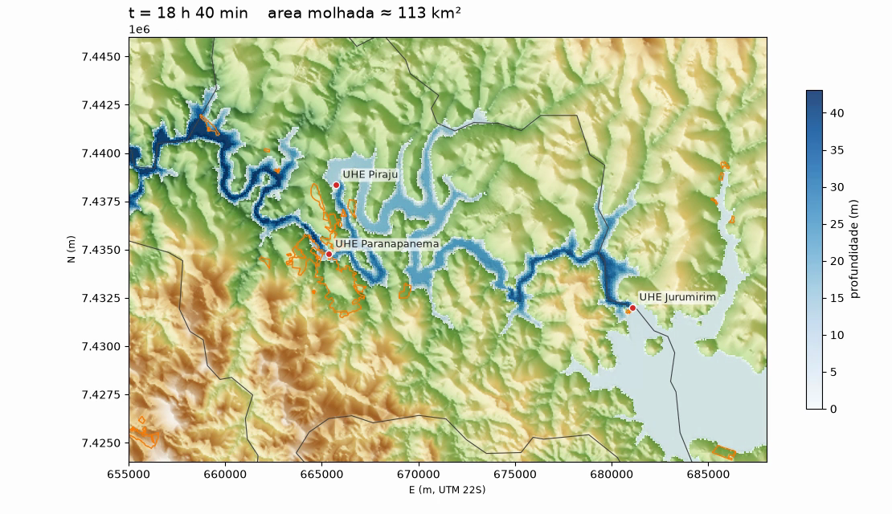

# Simulador complementar (ANUGA): cenário exploratório de volume

> **Estudo educacional independente; não substitui o PAE oficial, a Defesa Civil ou laudo de engenharia.**
> Cenário **hipotético de balanço de massa**. Não é previsão, não é ruptura, não é validado.

Este repositório (dashboard) **não tem simulação hidráulica própria**: ele reproduz e analisa o que os PAEs publicam. A pergunta «e se o volume inteiro chegasse ao vale?» exige propagar a água sobre o terreno, o que é feito num **repositório separado**: [`RenanCOliveira93/simulador-hidro-anuga`](https://github.com/RenanCOliveira93/simulador-hidro-anuga) (ANUGA, águas rasas 2D; roda em macOS e Linux).

## Por que um cenário de volume
Não se calcula a probabilidade de ruptura nem como ela ocorreria. Fixa-se uma **premissa**: 100 % do volume do reservatório de Jurumirim (**7.007,52 hm³**, N.A. máximo normal, PAE Jurumirim) chega ao vale a jusante. A pergunta passa a ser: *onde a água se espalharia, com que profundidade e quando, passando por Paranapanema e Piraju?* O tempo de esvaziamento (**72 h**, curva triangular com pico de 54.070 m³/s em 7,2 h) é **escolha do cenário**: um volume sozinho não define a vazão (6 h dariam ~650.000 m³/s; 7 dias, ~23.000 m³/s).

## Resultado (24 h simuladas) — SIMULAÇÃO EXPLORATÓRIA
| Item | Valor |
|---|---|
| Pico de profundidade no município de Piraju | **54,6 m às 18,5 h** (54,2 m aos 24 h); já não sobe, mas a entrada de água segue alta |
| Área molhada total aos 24 h | 112 km² |
| Área urbanizada de Piraju atingida (IBGE 2019, 8,3 km²) | **≈ 9 %** (0,76 km² acima de 0,1 m; 0,68 km² acima de 2 m) |
| Área rural atingida (497 km²) | **≈ 14 %** (72,9 km² acima de 0,1 m) |
| Chegada à barragem de Piraju / Paranapanema / entorno do centro | ≈ 5 h 20 / ≈ 6 h 30 / ≈ 7 h (rodada-teste de 12 h) |

Nesse cenário e com esse terreno, a água **fica no vale do rio**, e as manchas urbanas atingidas ficam junto à barragem de Paranapanema. Detalhes, tabelas, vídeo e como reproduzir: [`docs/RESULTADOS_JURUMIRIM_7007HM3.md`](https://github.com/RenanCOliveira93/simulador-hidro-anuga/blob/main/docs/RESULTADOS_JURUMIRIM_7007HM3.md) no repositório do simulador.

## O que isto NÃO mostra
- **Não prova que a cidade inteira seria poupada** nem atingida em outro cenário; é condicional às entradas.
- **Cascata não modelada:** Paranapanema e Piraju são **terreno elevado** (sem galgamento, vertedouro nem ruptura). Se o volume excede a capacidade de cada barragem, passar por cima ou romper é esperado; isso não está representado.
- **Relevo Copernicus 30 m** não resolve ruas, edificações nem o **leito do rio** (sem batimetria); profundidades de dezenas de metros no talvegue são ordem de grandeza. Malha de ~100 m, grossa para uma cidade.
- **Ponto de entrada assumido** (linha de 600 m a ~1,2 km a noroeste do eixo da barragem), não é a brecha. Bordas transmissivas: a água sai do domínio ainda profunda.
- **Balanço de massa de ponta a ponta não verificado** (vazão de saída não medida). **Sem calibração, sem teste de sensibilidade, sem testes automatizados, sem revisão por engenheiro hidráulico.**

## Como falar disto (vídeo e slides)
Selo na tela: **SIMULAÇÃO EXPLORATÓRIA · CENÁRIO HIPOTÉTICO DE VOLUME**. Nunca dizer «a barragem vai romper», «a cidade será/não será inundada» ou dar probabilidade. Dizer sempre «**se** este volume chegasse ao vale, **nestas premissas**…». Ver [`ROTEIRO_APRESENTACAO.md`](ROTEIRO_APRESENTACAO.md).
